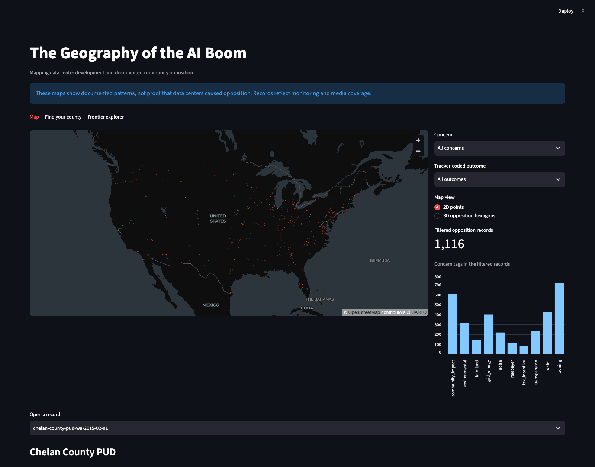
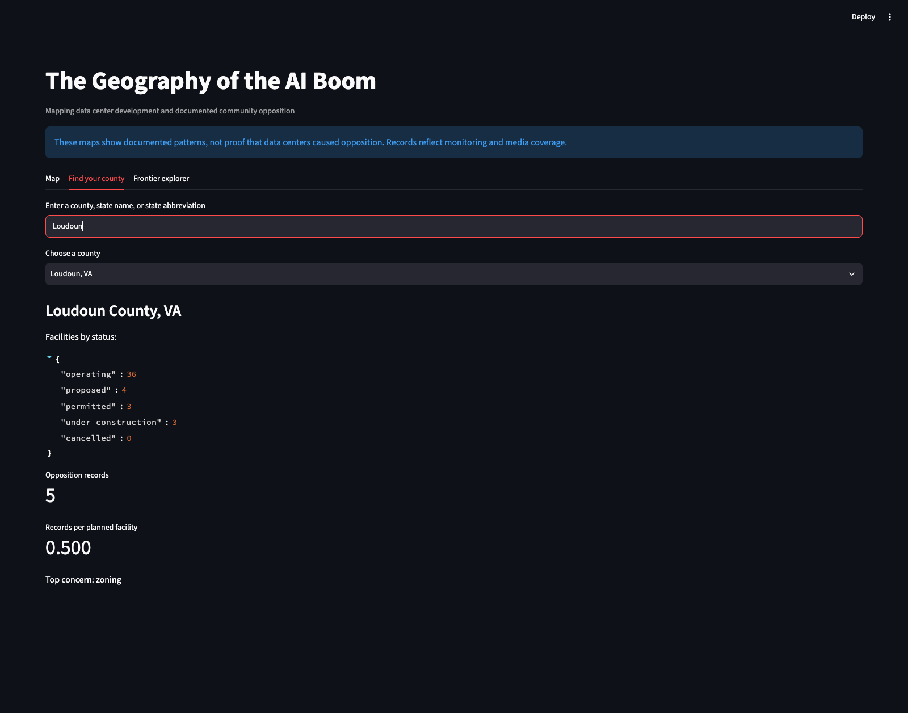
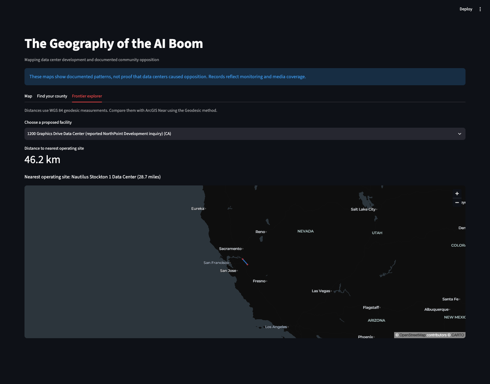

# The Geography of the AI Boom

### Mapping where data centers are growing — and where communities are speaking up.

As demand for AI grows, data centers are being built in communities across the United States. This project brings facility locations and public opposition records together on a map to explore where development is happening, what concerns people raise, and how those patterns compare.

> **The question:** Is the data center frontier also a place where communities are pushing back?

This is a geography project, not a claim that data centers cause any particular concern. The maps show documented patterns in public records; missing records do not mean a community has no concerns.

## Explore the project

The interactive app is designed for anyone to explore — no mapping experience needed.



*The map brings data center locations and documented opposition into one view. Use the controls to filter by concern or recorded outcome.*

### Find your county

Search for a county or state to see facilities by development status, documented opposition records, and the most frequently tagged concern.



### Explore the frontier

Choose a proposed facility to see how far it is from the nearest operating data center. The connecting line makes the distance easy to understand at a glance.



## What the data shows

For one documented comparison, counties with planned facilities and no more than one operating site are grouped as the **frontier**. Counties with at least five operating sites are grouped as **hubs**.

| Group | Counties | Planned facilities | Opposition records | Records per planned facility |
|---|---:|---:|---:|---:|
| Frontier | 451 | 692 | 555 | 0.80 |
| Hubs | 62 | 213 | 160 | 0.75 |

With these definitions, the frontier has a slightly higher number of documented opposition **records** per planned facility. The difference is small, and sensitivity checks show that comparisons can change when the hub cutoff changes. This is a useful starting point for exploration—not proof of a broad trend or a causal relationship.

Records describe actions such as public comments, petitions, or lawsuits; they are not necessarily unique community campaigns. The underlying data is based on monitoring and public coverage, so documented activity may be uneven across places.

## How to use the app

1. Start the app using the instructions below.
2. On **Map**, explore facility and opposition locations. Filter records by concern or tracker-coded outcome, and select a record to read its summary and follow its source links.
3. Open **Find your county**, then type a county name, state name, or state abbreviation. If a county name is shared, choose the matching state.
4. Open **Frontier explorer**, choose a proposed facility, and compare it with the nearest operating site. The distance is shown in both kilometers and miles.

## Run it on your computer

You need Python installed. From the project folder, run:

```bash
python3 -m venv .venv
source .venv/bin/activate
pip install -r requirements.txt
streamlit run app/app.py
```

The app opens in your browser and uses the prepared tables in `data/clean/`. The source downloads are not included in this repository. The Python scripts that prepare the data are in `scripts/`.

## What’s in the project

- `app/` — interactive map and county and frontier explorers
- `data/clean/` — prepared tables used by the app
- `scripts/` — data cleaning, county mapping, and summary analysis
- `arcgis/steps.md` — a guide to continuing the spatial analysis in ArcGIS Pro

## Data and credit

- **Community opposition:** [Data Center Opposition Tracker](https://github.com/Georgeingebretsen/datacenter-opposition-tracker), licensed under [CC BY 4.0](https://creativecommons.org/licenses/by/4.0/).
- **Data center facilities:** [SUEDA Data Center Registry](https://suedatacenters.org/data-centers/data), version 1.35.1; licensed under [CC BY 4.0](https://creativecommons.org/licenses/by/4.0/). The registry credits [Compute Atlas](https://doi.org/10.5281/zenodo.22284476).
- **County boundaries and population:** U.S. Census Bureau, 2025 county boundaries and July 1, 2025 population estimates.

## About

Created by **Kelvin Bonsu** for **EES 201: Introduction to GIS**. The project combines data analysis, mapping, and a public-facing app to make a fast-changing issue easier to explore.
